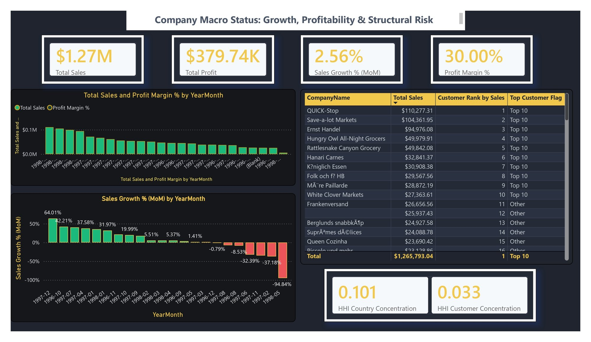

# پروژهٔ جامع هوش تجاری نورث‌ویند

این مخزن، خروجی یک **پروژهٔ گروهی سه‌نفره** در درس فناوری اطلاعات دانشگاه صنعتی شریف است. مسیر کار از شناخت کسب‌وکار و پاک‌سازی داده‌های Northwind شروع شد و با طراحی پایگاه داده، مهندسی SQL، مدل تحلیلی Power BI، تحلیل مدیریتی و ارائهٔ نتایج در وردپرس ادامه یافت.

[معرفی کامل انگلیسی](README.md) · [گزارش کامل پروژه](docs/Project_Report_Public.pdf) · [فایل Power BI](Phase_5_Strategic_Business_Intelligence_PowerBI/Phase_5_Group1.pbix)

## خروجی‌های مهم

- نوت‌بوک پاک‌سازی داده با Python: [مشاهده](Phase_1_DataPreprocessing_python/data_preprocessing.ipynb)
- فایل Excel عملیاتی و ماکروها: [مشاهده](Phase_2_Operational_Data_preparation_Excel/operational_analysis.xlsm)
- فایل Access شامل ساختار تراکنشی و داده‌های نمونه: [مشاهده](Phase_3_Transactional_Database_Design_Access/phase3_Group1.accdb)
- پنج اسکریپت طراحی و تحلیل SQL: [مشاهده](Phase_4_Data_Engineering_SQL/)
- فایل Power BI با هفت صفحهٔ تحلیلی: [مشاهده](Phase_5_Strategic_Business_Intelligence_PowerBI/Phase_5_Group1.pbix)
- گزارش کامل ۱۹۸ صفحه‌ای: [مشاهده](docs/Project_Report_Public.pdf)

## نکتهٔ تحلیلی

فروش نمونه در داشبورد حدود ۱٫۲۷ میلیون دلار است. سود در مدل با فرض حاشیهٔ سود ثابت ۳۰ درصد محاسبه شده؛ بنابراین همبستگی تخفیف با **حاشیهٔ سود** از نظر آماری تعریف‌پذیر نیست و داشبورد به‌جای عدد گمراه‌کننده، «N/A» نمایش می‌دهد. برای جزئیات، [تحلیل فنی](docs/PROJECT_ANALYSIS.md) و گزارش را ببینید.

## حدود انتشار

فایل Access با داده‌های **نمونهٔ نورث‌ویند** منتشر شده است. دامپ کامل SQL، CSVهای خام، بکاپ وردپرس و شماره‌های دانشجویی روی جلد گزارش عمومی منتشر نشده‌اند. فایل‌های Excel و Power BI نیز حاوی دادهٔ نمونه هستند و برای بازبینی خروجی‌های پروژه در مخزن قرار گرفته‌اند.
