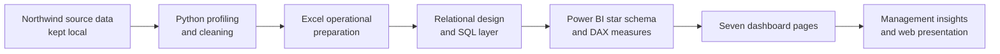
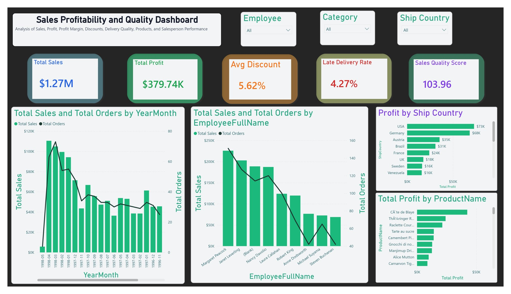
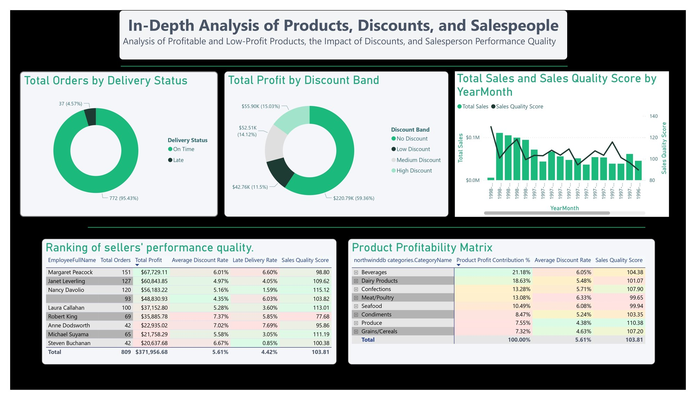
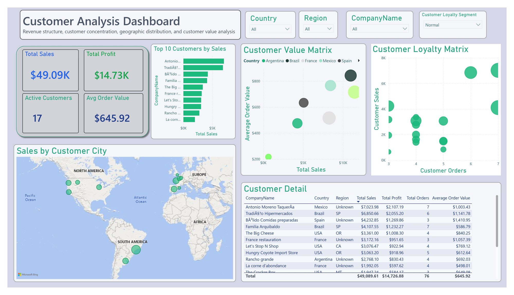
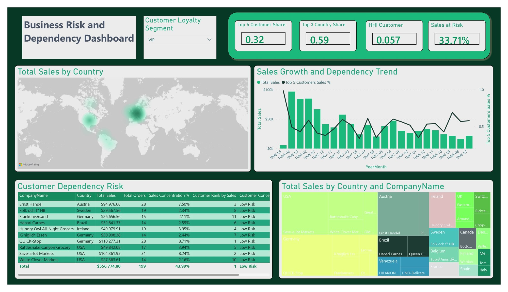
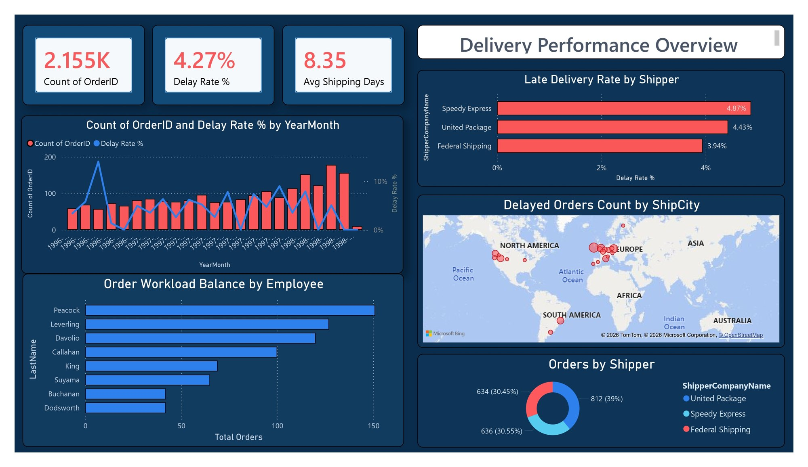
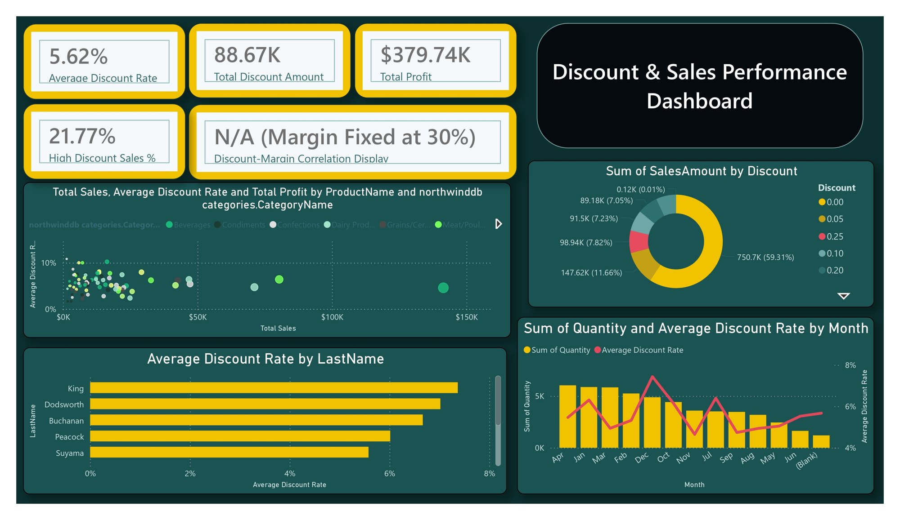

# Northwind: End-to-End Business Intelligence

**An academic group project that turns Northwind operational data into decision-ready reporting.** The work covers business understanding, Python and Excel preparation, relational modeling, SQL engineering, Power BI dashboards, managerial analysis, and web presentation.

**Explore:** [Full project report (PDF)](docs/Project_Report_Public.pdf) · [Power BI report](Phase_5_Strategic_Business_Intelligence_PowerBI/Phase_5_Group1.pbix) · [Technical analysis](docs/PROJECT_ANALYSIS.md) · [خلاصهٔ فارسی](README.fa.md)


> **Team project:** This was completed by a three-person Group 1 team at Sharif University of Technology. The submitted report describes shared work across the phases. This repository presents the team's work as a portfolio case study and does not claim sole authorship.

## At a glance

| Area | What was built |
| --- | --- |
| Business problem | Connect sales, customers, products, employees, shipping, and discounts to management decisions |
| Data | Northwind sample data; raw CSVs and database files stay outside this repository |
| Data preparation | Python cleaning notebook and a macro-enabled Excel operational workbook |
| Data engineering | Relational schema, analytical SQL, views, indexing, and performance exploration |
| Analytics model | `FactSales` with customer, employee, product, shipper, and date dimensions |
| Reporting | Seven Power BI report pages and a 198-page Persian project report |
| Delivery | A documented WordPress presentation phase; site backup is excluded |

## The end-to-end workflow



The analytical layer uses `FactSales` and dimensions for customers, employees, products, shippers, and dates. The SQL work also covers sales views, pricing and discount analysis, employee productivity, shipping costs, and index behavior. The [technical analysis](docs/PROJECT_ANALYSIS.md) explains the implementation and evidence in more detail.

## Phase-by-phase deliverables

| Phase | Focus | Portfolio artifact |
| --- | --- | --- |
| 0 | Business model, process map, data entities, and KPIs | [Project report](docs/Project_Report_Public.pdf) |
| 1 | Missing values, duplicates, types, outliers, and feature engineering | [Clean Python notebook](Phase_1_DataPreprocessing_python/data_preprocessing.ipynb) |
| 2 | Operational data preparation, Power Query, data validation, and VBA automation | [Excel workbook](Phase_2_Operational_Data_preparation_Excel/operational_analysis.xlsm) |
| 3 | Transactional schema, relationships, forms, and reports in Access | [Design documented in report](docs/Project_Report_Public.pdf) |
| 4 | MySQL schema, analytical queries, performance tuning, and reporting views | [Five SQL scripts](Phase_4_Data_Engineering_SQL/) |
| 5 | Star schema, DAX KPIs, and interactive Power BI pages | [Power BI file](Phase_5_Strategic_Business_Intelligence_PowerBI/Phase_5_Group1.pbix) and screenshots below |
| 6 | Management interpretation and strategic questions | [Analysis in report](docs/Project_Report_Public.pdf) |
| 7 | Local WordPress presentation of project results | [Implementation documented in report](docs/Project_Report_Public.pdf) |

## Dashboard gallery

These images were extracted from the submitted report. Click an image to view it at full size. The saved report pages may contain active filters, so metrics can differ between screenshots.

| Executive overview | Profitability and sales quality |
| :---: | :---: |
| [](docs/images/01-executive-overview.jpg) | [](docs/images/02-profitability-quality.jpg) |

| Product and employee deep dive | Customer analysis |
| :---: | :---: |
| [](docs/images/03-product-employee-deep-dive.jpg) | [](docs/images/04-customer-analysis.jpg) |

| Business risk and dependency | Logistics and shipping |
| :---: | :---: |
| [](docs/images/05-business-risk.jpg) | [](docs/images/06-logistics-shipping.jpg) |

| Pricing and discount strategy |
| :---: |
| [](docs/images/07-pricing-discounts.jpg) |

## Selected results and analytical judgment

The executive dashboard reports approximately **$1.27M in sales** and **$379.74K in modeled profit** on the sample dataset. Other saved views show an **average discount of 5.62%** and a **late-delivery rate of 4.27%**. These are project outputs, not live business figures.

The profit measure assumes a **fixed 30% margin**. Because its variance is zero, a Pearson correlation between discount and profit margin is undefined. The dashboard deliberately displays **“N/A (Margin Fixed at 30%)”** instead of a misleading number. The report also examines customer concentration, discount policy, employee workload, logistics, and product mix as management questions. See [Technical analysis](docs/PROJECT_ANALYSIS.md) for the assumptions behind these interpretations.

## How to review or run the project

**Fast review:** Read this page, open the seven screenshots, then read the [public report](docs/Project_Report_Public.pdf). The report has an English portfolio cover and retains the original Persian body.

**Power BI:** Open the [`.pbix` file](Phase_5_Strategic_Business_Intelligence_PowerBI/Phase_5_Group1.pbix) in Power BI Desktop to inspect its saved model and report pages. Refreshing the data requires a local Northwind source and matching connections.

**Excel:** Open the [macro-enabled workbook](Phase_2_Operational_Data_preparation_Excel/operational_analysis.xlsm) in Excel to inspect the operational model. It contains sample Northwind tables and VBA; refreshing source queries requires the original input files.

**Python:** Install dependencies, place the 13 original CSVs under `Phase_1_DataPreprocessing_python/dirty_data/`, and run the [notebook](Phase_1_DataPreprocessing_python/data_preprocessing.ipynb) from either the repository root or its phase folder:

```bash
python -m pip install -r requirements.txt
jupyter lab
```

**SQL:** The [five phase 4 scripts](Phase_4_Data_Engineering_SQL/) target a local MySQL Northwind database. Review them before execution: they include schema changes, views, indexes, and a stress-test section. Run them only against a disposable local database.

## Data policy and limitations

- No Access database, full SQL dump, raw CSV dataset, or WordPress site backup is published. SQL source files are included because they document the implementation, not the database contents.
- The Excel and Power BI files are analytical deliverables and contain embedded **sample Northwind data**. They are not live production systems.
- The report uses a modeled 30% profit margin; profit-related conclusions depend on that assumption.
- The original LaTeX source refers to 54 images at machine-specific paths and is kept locally. The public PDF retains the complete report body while removing student IDs from its cover.
- The full pipeline cannot be rerun from this repository alone because the raw data, local databases, and WordPress environment are intentionally excluded.

## Project context

Course: **Information Technology (21776)**, Sharif University of Technology, 2026. This is a three-person academic project based on the Northwind sample dataset. The repository preserves the team's technical deliverables and documents what was omitted for privacy, size, and portability.
